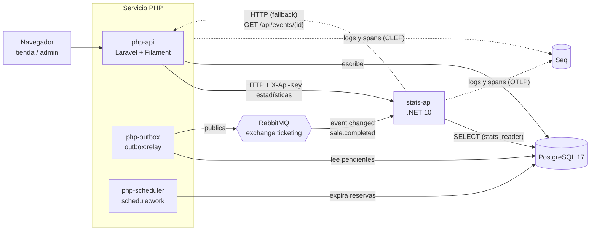

# Ticketing: venta de entradas para eventos

Sistema de venta de entradas compuesto por dos servicios que se integran entre sí y comparten una base PostgreSQL:

- **Servicio principal (PHP 8.4 / Laravel 12):** autenticación, gestión de eventos, reservas temporales, compras e historial. Expone una API REST (Sanctum) y dos paneles Filament: la **tienda** para clientes y el **panel de administración**.
- **Servicio de estadísticas (.NET 10):** consulta de eventos, estadísticas de ventas por evento y resumen general. Se comunica con PHP por HTTP y consume sus eventos de dominio por **RabbitMQ**.

Además de lo pedido incluye: carrito con reservas de 10 minutos, Docker Compose con arranque automático, mensajería con patrón *outbox*, frontend con Filament, observabilidad (logs estructurados, trazas distribuidas y alertas centralizadas en Seq) y tests automatizados en ambos servicios.

**Evidencia de integración:** [docs/integration-evidence.md](docs/integration-evidence.md) muestra, con salidas y capturas reales, los dos servicios comunicándose en los tres sentidos y recuperándose cuando cae .NET o RabbitMQ.

---

## Inicio rápido

Requisito: Docker (con Docker Compose v2). No hace falta tener PHP, Composer, .NET ni PostgreSQL instalados.

```bash
git clone <url-del-repo> ticketing
cd ticketing
docker compose up -d --build
```

El primer arranque tarda unos minutos (instala dependencias y compila ambas imágenes). El contenedor `php-api` prepara todo solo: crea el `.env` desde `.env.example`, genera `APP_KEY`, ejecuta migraciones y seeders, publica los assets de Filament y genera el Swagger. El resto de servicios esperan a que `php-api` esté *healthy*.

```bash
docker compose ps          # todos los servicios en "running" / "healthy"
```

Si cambian dependencias de Composer, reconstruir renovando el volumen de `vendor`:

```bash
docker compose up -d --build -V
```

Para restablecer la base con los datos de demo:

```bash
docker compose exec php-api php artisan migrate:fresh --seed
```

### URLs

| Qué | URL |
|---|---|
| Tienda (público, catálogo en la raíz) | http://localhost:8000 |
| Panel de administración | http://localhost:8000/admin |
| API REST de PHP | http://localhost:8000/api |
| Swagger de PHP | http://localhost:8000/api/documentation |
| API de estadísticas (.NET) | http://localhost:5000/api |
| Swagger de .NET | http://localhost:5000/swagger |
| RabbitMQ Management | http://localhost:15672 |
| Seq (logs, trazas y alertas) | http://localhost:5341 |

### Credenciales de demo (solo entorno local)

Son valores por defecto para levantar el proyecto en local; ya están en `docker-compose.yml`, `.env.example` y los seeders. En cualquier otro entorno se inyectan como variables de entorno y deben cambiarse.

| Uso | Usuario | Contraseña / valor |
|---|---|---|
| Admin (panel y API) | `admin@tickets.test` | `admin1234` |
| Cliente (tienda y API) | `customer@tickets.test` | `customer1234` |
| API key PHP → .NET (`X-Api-Key`) | — | `dev-stats-key` |
| PostgreSQL (dueño del esquema) | `tickets` | `secret` |
| PostgreSQL (solo lectura, .NET) | `stats_reader` | `stats_secret` |
| RabbitMQ | `tickets` | `secret` |
| Seq | `admin` | `seqadmin1234` |

El seeder crea además 25 clientes, 6 eventos (publicados, un borrador y uno cancelado) y ventas de demo generadas a través del servicio real de reservas (respetan stock, precios y transacciones).

---

## Arquitectura



| Contenedor | Responsabilidad |
|---|---|
| `postgres` | Base de datos. `docker/postgres/init.sh` crea la base de tests y el rol de solo lectura `stats_reader` (contraseña en `STATS_READER_PASSWORD`). |
| `php-api` | API REST, tienda y panel admin (`artisan serve` en el puerto 8000). Es el único que escribe datos de negocio. |
| `php-scheduler` | Tareas programadas: expira reservas vencidas y vigila el outbox cada minuto; limpia el outbox a diario. |
| `php-outbox` | Publica en RabbitMQ los mensajes pendientes del outbox. |
| `rabbitmq` | Broker de mensajería (con UI de administración). |
| `stats-api` | Servicio de estadísticas en .NET (puerto 5000). |
| `seq` | Centraliza logs, trazas y alertas de todos los servicios (UI en el puerto 5341). |
| `seq-setup` | Tarea de un solo uso: fija la contraseña de admin de Seq y crea las alertas. |

### Servicio PHP (Laravel 12)

Arquitectura en capas con la lógica de negocio centralizada en servicios, compartidos por la API y por Filament:

```
php-service/app/
├── Http/
│   ├── Controllers/     # Delgados: delegan en los servicios
│   ├── Requests/        # Validación de entrada (FormRequest)
│   ├── Resources/       # Forma de las respuestas JSON
│   └── Middleware/
├── Services/            # Reglas de negocio y transacciones
│   ├── AuthService.php
│   ├── EventService.php
│   ├── ReservationService.php
│   └── StatsClient.php  # Cliente HTTP hacia .NET
├── Messaging/           # Outbox y publicación en RabbitMQ
├── Observability/       # Contexto de traza W3C y envío de logs a Seq
├── Models/  Enums/  Policies/  Exceptions/
├── Filament/            # Panel admin
│   └── Store/           # Tienda para clientes
└── OpenApi/             # Anotaciones de Swagger (l5-swagger)
```

- **Flujo de una petición:** `FormRequest` (valida) → `Controller` → `Service` (reglas + transacción) → `Model`. Las violaciones de reglas de negocio se lanzan como excepciones de dominio que el handler global convierte en respuestas JSON coherentes (422, 409, 404…).
- **Autorización:** Sanctum para la API (tokens Bearer) y sesión web para Filament. Las `Policies` deciden quién puede qué (solo admin gestiona eventos; cada cliente solo ve y opera sus reservas y compras).
- **Dos paneles Filament sobre los mismos servicios:**
  - **Tienda** (`/`): catálogo público, ficha del evento, carrito con cuenta regresiva y historial de compras. Ver eventos no requiere login; reservar sí.
  - **Admin** (`/admin`, solo rol `admin`): CRUD de eventos y cambios de estado, ventas, usuarios y un dashboard cuyos widgets consumen las estadísticas de .NET. Si .NET no responde, los widgets muestran un aviso en vez de romper la página.
- **Estados del evento:** `draft → published | cancelled`, `published → cancelled | finished`. Los borradores no son visibles para clientes (responden 404); los cancelados y terminados siguen consultables para historial y reportes.

#### Flujo de compra

1. **Reservar:** en una transacción con `SELECT … FOR UPDATE` sobre el evento se valida el stock, se descuenta `available_tickets` y se crea una reserva `pending` que vence en 10 minutos. El bloqueo serializa compras concurrentes del mismo evento: no puede venderse más de lo disponible.
2. **Carrito:** la reserva aparece con cuenta regresiva. Un índice único parcial impide tener dos reservas pendientes del mismo evento.
3. **Confirmar:** bloquea la reserva, verifica que siga vigente y crea la venta (`ticket_sales`) con el precio unitario congelado.
4. **Vencer o cancelar:** el scheduler expira cada minuto las reservas vencidas (con `SKIP LOCKED`, para no chocar con una confirmación en curso) y devuelve las entradas al stock.

### Servicio .NET (Vertical Slice + Minimal APIs)

Cada caso de uso es un *slice* autocontenido (endpoint, handler, acceso a datos y contrato de respuesta); lo transversal vive en `Infrastructure`:

```
dotnet-service/src/StatsService.Api/
├── Features/
│   ├── Events/          # Consulta de eventos (vía PHP)
│   ├── EventStats/      # Estadísticas de un evento
│   ├── SalesSummary/    # Resumen general de ventas
│   └── Sync/            # Handlers de mensajes de RabbitMQ
└── Infrastructure/
    ├── Php/             # Cliente HTTP a PHP, réplica de eventos y decorador
    ├── Messaging/       # Consumidor de RabbitMQ
    ├── Caching/         # Tags de caché y caché que conserva la traza
    ├── Observability/   # OpenTelemetry y ActivitySource propio
    ├── Security/        # Middleware de API key
    └── Errors/          # Excepciones → ProblemDetails
```

- **Lecturas con Dapper** sobre PostgreSQL usando el rol `stats_reader`, que solo tiene `SELECT`: .NET no puede modificar datos de negocio ni aunque quisiera.
- **Seguridad:** todos los endpoints `/api` exigen el header `X-Api-Key`; Swagger es público.
- **Errores:** respuestas `application/problem+json` (RFC 7807) para 400, 401, 404 y 503, con el `trace_id` de la petición.
- **Caché:** `HybridCache` con tags (`summary`, `event:{id}`) sobre los endpoints de estadísticas, invalidada por los mensajes de RabbitMQ.

---

## Comunicación entre servicios

Los dos servicios se comunican en ambos sentidos, combinando llamadas síncronas (HTTP) y mensajería asíncrona (RabbitMQ).

### PHP → .NET: consulta de estadísticas (HTTP síncrono)

El dashboard de admin necesita estadísticas al momento, así que `StatsClient` llama por HTTP a .NET con `X-Api-Key`:

- `GET /api/stats/summary?top=N`: resumen global para los widgets del dashboard.
- `GET /api/stats/events/{id}`: estadísticas en la ficha de un evento.

Con timeouts cortos y degradación controlada: si .NET falla, PHP lanza `StatsUnavailableException` y el widget muestra un aviso.

### PHP → RabbitMQ → .NET: eventos de dominio (asíncrono)

Cuando cambia algo relevante, PHP lo anuncia como mensaje:

| Mensaje | Cuándo | Contenido |
|---|---|---|
| `event.changed` | Crear, editar o cambiar el estado de un evento, y cada cambio de stock (reservar, cancelar, vencer) | Foto completa del evento |
| `sale.completed` | Confirmar una compra | Venta (evento, cantidad, importe, fecha) |

**Patrón outbox (lado PHP).** El servicio no publica directamente en RabbitMQ: guarda el mensaje en la tabla `outbox_messages` **dentro de la misma transacción** que el cambio que anuncia. Así:

- si la transacción hace rollback, el mensaje desaparece con ella (nunca se anuncia algo que no ocurrió);
- si RabbitMQ está caído, la venta se completa igual y el mensaje espera en la tabla (no se pierde).

El contenedor `php-outbox` (`php artisan outbox:relay`) recorre los pendientes en orden, los publica con *publisher confirms* y mensajes persistentes, y los marca como publicados. Si el broker falla, reintenta con backoff exponencial. La entrega es *at-least-once*: un mensaje puede llegar duplicado y el consumidor está preparado para ello.

Cada mensaje viaja con este sobre:

```json
{
  "message_id": "33bd3de5-a293-4130-aa1e-387ee41326f3",
  "type": "event.changed",
  "sequence": 42,
  "occurred_at": "2026-11-25T02:09:12+00:00",
  "data": { "id": 1, "name": "Los Prisioneros en vivo", "available_tickets": 460, "status": "published", "...": "..." }
}
```

`sequence` es el id autoincremental del outbox: crece en el orden en que se confirmaron los cambios de un mismo evento (la fila del evento está bloqueada hasta el commit).

**Consumidor (lado .NET).** `RabbitMqConsumer` es un `BackgroundService` que:

- declara su propia topología: la cola durable `stats-service.ticketing`, enlazada al exchange topic `ticketing` por cada tipo de mensaje que sabe procesar, y una *dead-letter queue* (`stats-service.ticketing.dlq`);
- confirma cada mensaje (ack manual) solo después de procesarlo. Si un mensaje falla, va a la DLQ en lugar de reintentarse en bucle;
- si RabbitMQ no está disponible, reintenta la conexión con backoff sin afectar a la API.

Los mensajes se usan para dos cosas:

1. **Réplica de eventos en memoria.** `event.changed` actualiza `EventReplica`, que solo aplica un mensaje si su `sequence` es mayor que la guardada; así se descartan duplicados y mensajes fuera de orden.
2. **Invalidación de caché.** Ambos mensajes invalidan los tags `event:{id}` y `summary`, de modo que la siguiente consulta recalcula cifras frescas.

### .NET → PHP: datos del evento (HTTP, como respaldo)

Las estadísticas de un evento combinan dos fuentes, consultadas en paralelo:

- **Ventas** (totales, ventas por día, entradas retenidas): SQL directo con `stats_reader`, con agregaciones `JOIN` / `GROUP BY` que serían costosas de reconstruir por HTTP.
- **Datos del evento** (nombre, estado, capacidad, disponibilidad): PHP es la fuente de verdad.

Para lo segundo, `ReplicatedEventsClient` (un decorador de `IEventsClient`) consulta primero la réplica en memoria y **solo si el evento no está o su copia tiene más de 10 minutos** lo pide a PHP por HTTP (`GET /api/events/{id}`) y lo guarda. Este cliente HTTP tiene resiliencia (reintentos con backoff, timeout por intento y *circuit breaker*); si PHP no responde, .NET devuelve `503` en formato ProblemDetails.

En funcionamiento normal .NET no llama a PHP: los mensajes mantienen la réplica al día. El HTTP solo entra en juego tras un reinicio de .NET (réplica vacía) o si una copia caduca. El listado `GET /api/events` sí se delega siempre a PHP, porque necesita su búsqueda y paginación.

### Ejemplo de punta a punta

Medido sobre el entorno local:

| Paso | Estadísticas en .NET | Llamadas .NET → PHP |
|---|---|---|
| Primera consulta tras reiniciar .NET | sold 38 · available 462 | 1 (fallback HTTP) |
| Un cliente reserva 3 entradas | on_hold 3 · available 459 | 0 |
| El cliente confirma la compra | sold 41 · on_hold 0 | 0 |

Se puede observar en vivo en RabbitMQ Management (colas `stats-service.ticketing` y `.dlq`) y, con todo el recorrido de cada operación, en Seq (ver [Observabilidad](#observabilidad)). Las capturas de cada escenario, incluidas las caídas de .NET y de RabbitMQ, están en la [evidencia de integración](docs/integration-evidence.md).

---

## Observabilidad

Objetivo: ante cualquier error, encontrar en un solo lugar **todo el recorrido** de la operación que lo causó, aunque haya pasado por PHP, RabbitMQ y .NET.

### Trazas distribuidas (W3C `traceparent`)

Cada operación tiene un `trace_id` que viaja con ella por todos los saltos, usando el estándar W3C `traceparent` (el mismo de OpenTelemetry). Cada servicio crea su propio *span* colgado del span de quien lo llamó:

| Salto | Cómo viaja la traza |
|---|---|
| Cliente → PHP | El middleware global `PropagateTraceContext` continúa el `traceparent` entrante o crea uno nuevo, y lo devuelve en el header `X-Trace-Id` |
| PHP → .NET (HTTP) | `StatsClient` envía el header `traceparent`; ASP.NET Core lo lee de forma nativa |
| PHP → RabbitMQ → .NET | Se guarda en la columna `outbox_messages.traceparent` **dentro de la transacción**, el relay lo publica como header AMQP y el consumidor .NET continúa la traza al procesar el mensaje |
| .NET → PHP (fallback) | `HttpClient` propaga el `traceparent` automáticamente |
| Tareas programadas | Cada ejecución de `reservations:expire` inicia su propia traza, que siguen los mensajes que genera |

Un detalle resuelto en .NET: con un token cancelable (`RequestAborted`), `HybridCache` ejecuta la carga desacoplada de la petición, y la traza se perdía justo en la llamada a PHP. `GetOrCreateTracedAsync` la captura y la continúa (cubierto por un test).

### Logs estructurados

- **PHP:** un JSON por línea a stderr (canal `json`) y el mismo evento a Seq (canal `seq`). Todo log de una petición lleva `trace_id` y `span_id`, y cada petición deja una línea `HTTP {method} {path}` con status y duración.
- **.NET:** JSON por consola con `TraceId` y `SpanId` en cada línea; con OpenTelemetry exporta logs y spans a Seq por OTLP.
- **Errores:** todas las respuestas de error de ambos servicios incluyen el `trace_id`, también los 500, que no exponen ningún detalle interno:

```json
{ "message": "Server Error", "trace_id": "4bf92f3577b34da6a3ce929d0e0e4736" }
```

### Seq: logs y trazas en un solo lugar

http://localhost:5341 (`admin` / `seqadmin1234`). Para seguir una operación, filtrar por su traza:

```
@TraceId = '4bf92f3577b34da6a3ce929d0e0e4736'
```

y abrir la vista de traza desde cualquier evento (*Trace → Show*). Una compra se ve así:

```
php-api    HTTP POST /api/events/3/reservations          215 ms
  stats-api  stats-service.ticketing process               36 ms   ← procesa el event.changed de esa reserva
php-api    HTTP POST /api/reservations/89/confirm          74 ms
  stats-api  stats-service.ticketing process                2 ms   ← procesa el sale.completed
```

Y una consulta de estadísticas que necesita el fallback encadena los cinco spans: petición a .NET → `cache populate` → llamada HTTP a PHP → petición en PHP.

**Recorrido de una compra.** Cada petición es su propia traza, así que reservar y confirmar desde la tienda son dos trazas distintas. Para unirlas, `ReservationService` registra eventos de negocio (`Reservation created`, `Purchase confirmed`, `Reservation released`) con `reservation_id`, `event_id` y `user_id`, y solo cuando la transacción se confirma. En Seq:

```
reservation_id = 93   → la reserva y la compra, cada una con su traza
user_id = 2           → todo lo que hizo ese cliente, en orden
```

**Acciones de la tienda y el admin.** Todas las acciones de Filament llegan a `POST /livewire/update`, así que el span se nombra con el componente y la acción: `Livewire ViewEvent::reserve`, `Livewire ListReservations::confirm`.

- **.NET** usa OpenTelemetry (instrumentación de ASP.NET Core, `HttpClient` y el `ActivitySource` propio) con exportador OTLP. Solo se activa si existe `OTEL_EXPORTER_OTLP_ENDPOINT`, así que los tests y `dotnet run` no necesitan Seq.
- **PHP** envía sus logs en el formato nativo de Seq (CLEF) con `SeqHandler`. La línea de cada petición lleva su hora de inicio, por lo que Seq la muestra como un span con duración dentro de la traza.
- **Best-effort:** si Seq no responde, PHP deja de intentarlo durante 30 s y ninguna petición falla por ello; los logs siguen saliendo por stderr (`docker compose logs`).

### Alertas

| Señal | Origen | Alerta en Seq |
|---|---|---|
| Logs de error o fatales | Cualquier servicio | **Errors in any service** |
| Mensajes en la dead-letter queue | El consumidor .NET revisa la DLQ cada minuto y avisa mientras tenga mensajes (`DeadLetterCount`) | **Dead-letter queue not empty** |
| Mensajes del outbox sin publicar durante más de 2 minutos | `outbox:monitor` en el scheduler, fuera del relay (si el relay cae, no podría avisar de sí mismo) | **Outbox backlog** |

`seq-setup` crea las alertas en cada arranque si no existen. No tienen canal de notificación configurado: su estado e historial se ven en Seq → *Alerts*. El mensaje que acaba en la DLQ conserva su header `traceparent`, así que desde la cola se llega a la traza del fallo.

### Ejemplo: rastrear un error

```bash
# 1. Una petición falla y la respuesta trae su trace_id
curl -s http://localhost:8000/api/events/99999 -H "Accept: application/json"
# {"message":"Resource not found.","trace_id":"7c95..."}

# 2. En Seq: @TraceId = '7c95...'  → todos los logs y spans de esa petición, en cualquier servicio

# 3. Sin Seq, el mismo trace_id sirve en los logs de los contenedores
docker compose logs php-api php-outbox stats-api | grep 7c95...
```

---

## Base de datos

Migraciones en `php-service/database/migrations`. Los estados se guardan como `VARCHAR` con `CHECK` (no ENUM de PostgreSQL, que es más rígido de migrar), el dinero como `NUMERIC(12,2)` y las fechas como `timestamptz`.

| Tabla | Integridad e índices destacados |
|---|---|
| `users` | `email` único · `CHECK role IN ('admin','customer')` |
| `events` | `CHECK available_tickets BETWEEN 0 AND total_tickets` (la base rechaza la sobreventa aunque se salte la aplicación) · `CHECK` de estado, precio y capacidad · índice `(status, event_date)` |
| `reservations` | FK a usuario y evento · `CHECK quantity BETWEEN 1 AND 10` · índice único parcial: una sola reserva `pending` por usuario y evento · índice parcial de vencimiento para el job de expiración |
| `ticket_sales` | FK a usuario, evento y reserva (única: una reserva genera como mucho una venta) · `CHECK total_amount = quantity * unit_price` · índices `(user_id, purchase_date)` para el historial y `(event_id, status)` para las estadísticas |
| `outbox_messages` | `message_id` único · índice parcial sobre los pendientes (`WHERE published_at IS NULL`) |

Las consultas de .NET (`EventSalesReader`, `SalesSummaryReader`) envían varias sentencias en un solo round-trip y usan `JOIN`, `GROUP BY`, `COUNT(DISTINCT …)` y `SUM` apoyándose en esos índices.

---

## API

La documentación interactiva completa está en Swagger (PHP: `/api/documentation`, .NET: `/swagger`). Resumen:

### PHP (`http://localhost:8000/api`)

| Método | Ruta | Acceso |
|---|---|---|
| POST | `/auth/register` · `/auth/login` | Público |
| POST | `/auth/logout` · GET `/auth/me` | Autenticado |
| GET | `/events` · `/events/{id}` · `/events/{id}/availability` | Público (borradores solo admin) |
| POST · PUT | `/events` · `/events/{id}` | Admin |
| PATCH | `/events/{id}/status` | Admin |
| POST | `/events/{id}/reservations` | Autenticado |
| GET | `/reservations/{id}` | Dueño de la reserva |
| POST | `/reservations/{id}/confirm` · `/reservations/{id}/cancel` | Dueño de la reserva |
| GET | `/me/purchases` | Autenticado |

### .NET (`http://localhost:5000/api`, header `X-Api-Key`)

| Método | Ruta | Descripción |
|---|---|---|
| GET | `/events` · `/events/{id}` | Eventos, obtenidos del servicio PHP |
| GET | `/stats/events/{id}` | Ocupación, ingresos, ticket promedio, entradas retenidas y ventas por día |
| GET | `/stats/summary?top=5` | Totales globales, eventos por estado y top de eventos por ingresos |

### Ejemplos de uso

```bash
# Login (devuelve un token Bearer)
TOKEN=$(curl -s -X POST http://localhost:8000/api/auth/login \
  -H "Accept: application/json" -H "Content-Type: application/json" \
  -d '{"email":"customer@tickets.test","password":"customer1234"}' \
  | grep -o '"token":"[^"]*"' | cut -d'"' -f4)

# Eventos publicados y disponibilidad
curl -s http://localhost:8000/api/events -H "Accept: application/json"
curl -s http://localhost:8000/api/events/1/availability -H "Accept: application/json"

# Reservar 2 entradas (retiene stock 10 minutos)
curl -s -X POST http://localhost:8000/api/events/1/reservations \
  -H "Accept: application/json" -H "Authorization: Bearer $TOKEN" \
  -H "Content-Type: application/json" -d '{"quantity":2}'

# Confirmar la compra (usar el id devuelto por la reserva)
curl -s -X POST http://localhost:8000/api/reservations/<id>/confirm \
  -H "Accept: application/json" -H "Authorization: Bearer $TOKEN"

# Historial de compras
curl -s http://localhost:8000/api/me/purchases \
  -H "Accept: application/json" -H "Authorization: Bearer $TOKEN"

# Estadísticas en .NET
curl -s http://localhost:5000/api/stats/events/1 -H "X-Api-Key: dev-stats-key"
curl -s "http://localhost:5000/api/stats/summary?top=3" -H "X-Api-Key: dev-stats-key"
```

Como admin (`admin@tickets.test`), además:

```bash
ADMIN_TOKEN=$(curl -s -X POST http://localhost:8000/api/auth/login \
  -H "Accept: application/json" -H "Content-Type: application/json" \
  -d '{"email":"admin@tickets.test","password":"admin1234"}' \
  | grep -o '"token":"[^"]*"' | cut -d'"' -f4)

# Crear un evento (nace en borrador) y publicarlo
curl -s -X POST http://localhost:8000/api/events \
  -H "Accept: application/json" -H "Authorization: Bearer $ADMIN_TOKEN" -H "Content-Type: application/json" \
  -d '{"name":"Indie Fest","description":"Three stages","event_date":"2027-03-10T20:00:00Z","ticket_price":35,"total_tickets":300}'

curl -s -X PATCH http://localhost:8000/api/events/<id>/status \
  -H "Accept: application/json" -H "Authorization: Bearer $ADMIN_TOKEN" -H "Content-Type: application/json" \
  -d '{"status":"published"}'
```

---

## Tests

```bash
# PHP (PHPUnit, contra la base tickets_test)
docker compose exec php-api php artisan test

# .NET (xUnit), con el SDK de .NET 10 instalado localmente
cd dotnet-service && dotnet test
```

- **PHP (98 tests):** autenticación, CRUD y estados de eventos, reservas (stock, expiración, doble confirmación, aislamiento entre usuarios, sobreventa bloqueada por la base), outbox (mensaje dentro de la transacción, rollback, orden, fallo del broker y vigilancia de pendientes), cliente de estadísticas, paneles Filament (tienda, carrito, compras y acceso al admin) y observabilidad (`traceparent`, propagación al outbox y a .NET, `trace_id` en errores, envío a Seq, logs de negocio y nombres de spans de Livewire).
- **.NET (33 tests):** handlers con fakes, cliente HTTP a PHP (errores y resiliencia), réplica de eventos (orden, duplicados, caducidad), decorador con fallback, handler de mensajes con el JSON real de PHP, extracción de la traza de los mensajes, caché que conserva la traza y tests de API con `WebApplicationFactory` (API key, ProblemDetails con `trace_id`, validación e invalidación de caché por mensaje).

---

## Despliegue

Para publicarlo en un servidor se usa el mismo compose con `docker-compose.prod.yml` encima: Caddy como único punto de entrada con HTTPS automático, el resto de puertos cerrados a internet, `APP_ENV=production` y las contraseñas en un `.env` del servidor (plantilla en `.env.prod.example`).

```bash
docker compose -f docker-compose.yml -f docker-compose.prod.yml up -d --build
```

Guía paso a paso (firewall, Docker, configuración y operación): [docs/deploy.md](docs/deploy.md).

---

## Variables de entorno

### PHP (`php-service/.env`, se crea desde `.env.example`)

| Variable | Por defecto | Descripción |
|---|---|---|
| `DB_HOST` · `DB_DATABASE` · `DB_USERNAME` · `DB_PASSWORD` | `postgres` · `tickets` · `tickets` · `secret` | Conexión a PostgreSQL |
| `SANCTUM_TOKEN_EXPIRATION` | `1440` | Minutos de validez del token de la API |
| `ADMIN_EMAIL` · `ADMIN_PASSWORD` | `admin@tickets.test` · `admin1234` | Admin creado por el seeder |
| `RESERVATION_TTL_MINUTES` | `10` | Duración de una reserva |
| `STATS_API_URL` · `STATS_API_KEY` | `http://stats-api:5000` · `dev-stats-key` | Servicio .NET |
| `RABBITMQ_HOST` · `RABBITMQ_PORT` · `RABBITMQ_USER` · `RABBITMQ_PASSWORD` · `RABBITMQ_VHOST` · `RABBITMQ_EXCHANGE` | `rabbitmq` · `5672` · `tickets` · `secret` · `/` · `ticketing` | Broker para el outbox |
| `PHP_CLI_SERVER_WORKERS` | `4` | Workers de `artisan serve`; necesarios porque una petición del dashboard llama a .NET y .NET puede llamar de vuelta a PHP |
| `SESSION_DRIVER` | `file` | Sesiones de Filament |
| `LOG_STACK` | `json,seq` | Canales de log: JSON a stderr y Seq |
| `SEQ_URL` · `SERVICE_NAME` | vacío · `php-api` | Seq y nombre del servicio en los logs; el compose los define por contenedor (`php-api`, `php-outbox`, `php-scheduler`) |

### .NET (variables de entorno en `docker-compose.yml`)

| Variable | Descripción |
|---|---|
| `ConnectionStrings__Stats` | Conexión a PostgreSQL con `stats_reader` |
| `PhpApi__BaseUrl` | URL base de la API de PHP (`http://php-api:8000/api`) |
| `Security__ApiKey` | API key exigida en `X-Api-Key` (toma `STATS_API_KEY`, por defecto `dev-stats-key`) |
| `RabbitMq__Host` · `RabbitMq__UserName` · `RabbitMq__Password` | Conexión al broker |
| `RabbitMq__Enabled` | `false` desactiva el consumidor (se usa en los tests) |
| `OTEL_SERVICE_NAME` · `OTEL_EXPORTER_OTLP_ENDPOINT` · `OTEL_EXPORTER_OTLP_PROTOCOL` | Variables estándar de OpenTelemetry; sin endpoint no se exporta nada |

### Docker Compose

| Variable | Por defecto | Descripción |
|---|---|---|
| `STATS_API_KEY` | `dev-stats-key` | API key compartida entre PHP y .NET |
| `SEQ_ADMIN_PASSWORD` | `seqadmin1234` | Contraseña del admin de Seq (se fija en el primer arranque) |

Para ejecutar .NET fuera de Docker (`dotnet run`), `appsettings.Development.json` apunta a `localhost` con las credenciales de demo.
