# Evidencia de integración

Este documento demuestra, con salidas y capturas reales, que el servicio PHP y el servicio .NET se comunican en los tres sentidos (HTTP PHP → .NET, mensajería PHP → RabbitMQ → .NET y HTTP .NET → PHP) y que la integración sigue funcionando cuando falla una de las piezas.

Los tests automatizados de cada servicio usan dobles (fakes) del otro servicio; este documento cubre lo que ellos no pueden: **los servicios reales funcionando juntos**.

- Entorno: `docker compose up -d --build` desde un clon limpio, con los datos de demo (`php artisan migrate:fresh --seed`).
- Herramientas de observación: Seq (http://localhost:5341, `admin` / `seqadmin1234`), RabbitMQ Management (http://localhost:15672, `tickets` / `secret`) y `docker compose logs`.
- Las capturas de Seq muestran la hora local del navegador (UTC-4); los logs y la base de datos, UTC. Por eso una misma operación aparece como `21:52` en Seq y `01:52` en los logs.

## Índice

1. [PHP → .NET: estadísticas por HTTP](#1-php--net-estadísticas-por-http)
2. [PHP → RabbitMQ → .NET: una compra de punta a punta](#2-php--rabbitmq--net-una-compra-de-punta-a-punta)
3. [.NET → PHP: fallback HTTP](#3-net--php-fallback-http)
4. [Resiliencia: .NET caído y RabbitMQ caído](#4-resiliencia)
5. [Errores rastreables, dead-letter queue y alertas](#5-errores-rastreables-dead-letter-queue-y-alertas)
6. [Cómo reproducirlo](#6-cómo-reproducirlo)

---

## 1. PHP → .NET: estadísticas por HTTP

El dashboard del panel de administración no calcula nada: pide las estadísticas al servicio .NET con `StatsClient` (header `X-Api-Key` y `traceparent`).

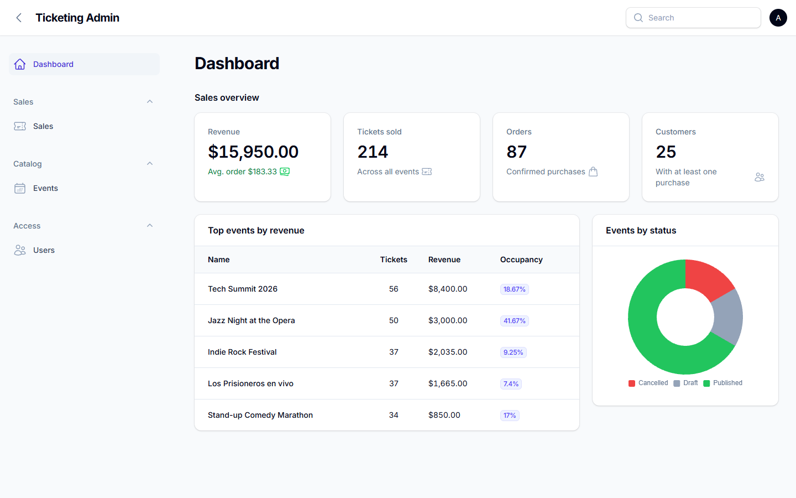

La misma información, pedida directamente a .NET:

```bash
curl -s "http://localhost:5000/api/stats/summary?top=3" -H "X-Api-Key: dev-stats-key"
```

```json
{
  "sales": { "orders": 87, "tickets_sold": 214, "revenue": 15950.00, "customers": 25, "average_order_value": 183.33 },
  "events_by_status": [
    { "status": "cancelled", "events": 1, "capacity": 400 },
    { "status": "draft", "events": 1, "capacity": 800 },
    { "status": "published", "events": 4, "capacity": 1120 }
  ],
  "top_events": [
    { "event_id": 3, "name": "Tech Summit 2026", "tickets_sold": 56, "revenue": 8400.00, "occupancy_percent": 18.67 },
    { "event_id": 2, "name": "Jazz Night at the Opera", "tickets_sold": 50, "revenue": 3000.00, "occupancy_percent": 41.67 },
    { "event_id": 6, "name": "Indie Rock Festival", "tickets_sold": 37, "revenue": 2035.00, "occupancy_percent": 9.25 }
  ],
  "generated_at": "2026-11-26T01:48:52.471392+00:00"
}
```

En Seq, la carga del widget del dashboard es una sola traza que atraviesa los dos servicios: el componente Livewire en PHP llama a .NET, que calcula el resumen (`cache populate`, la consulta SQL agregada) y lo guarda en caché.

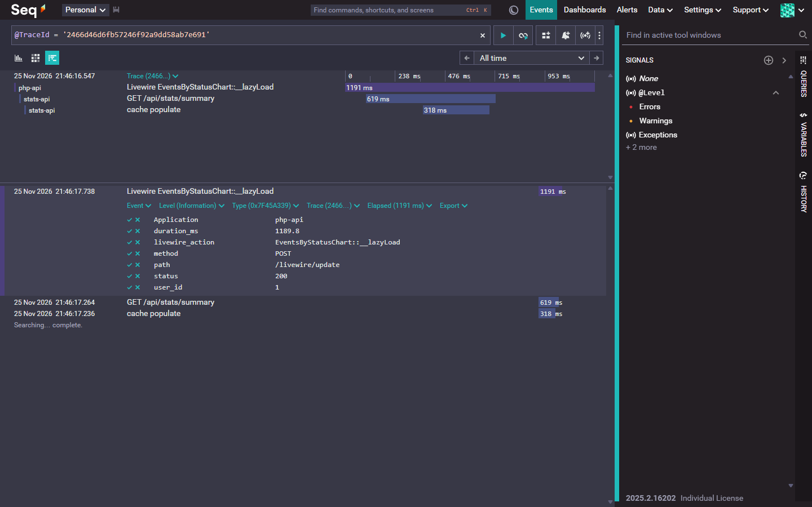

| Span | Servicio | Duración |
|---|---|---|
| `Livewire EventsByStatusChart::__lazyLoad` | php-api | 1191 ms |
| └ `GET /api/stats/summary` | stats-api | 619 ms |
| &nbsp;&nbsp;└ `cache populate` | stats-api | 318 ms |

Las siguientes recargas del dashboard responden desde la caché de .NET en microsegundos, hasta que un mensaje de RabbitMQ la invalida (sección 2).

---

## 2. PHP → RabbitMQ → .NET: una compra de punta a punta

Un cliente compra 2 entradas de *Los Prisioneros en vivo* (evento 1) desde la tienda: reserva y luego confirma. Antes, durante y después se consultan las estadísticas en .NET:

| Momento | `sold` | `on_hold` | `available` | Llamadas .NET → PHP |
|---|---|---|---|---|
| Antes de reservar | 37 | 0 | 463 | 1 (primera consulta tras el reinicio: carga el evento por fallback) |
| Reserva de 2 entradas creada | 37 | **2** | **461** | 0 |
| Compra confirmada | **39** | **0** | 461 | 0 |

Las cifras cambian **sin que .NET pregunte a PHP**: le llegan por RabbitMQ. El recuento de llamadas sale de los logs de `php-api` (`GET /api/events/1`).

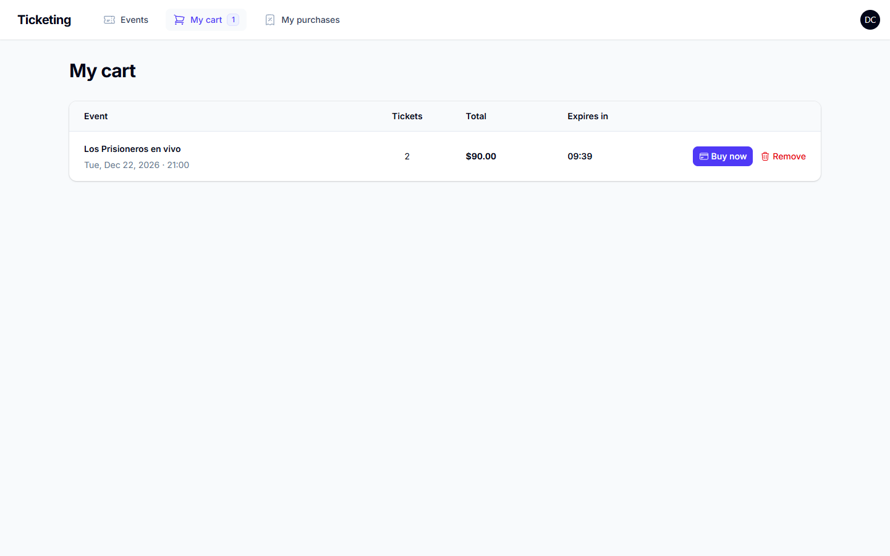

**Outbox (lado PHP).** Cada cambio se guarda como mensaje dentro de la misma transacción que la reserva o la venta, con la traza de la petición que lo originó, y el relay lo publica en el mismo segundo:

```
 id  |      type      | data_id | available |                traceparent                | created  | published
-----+----------------+---------+-----------+-------------------------------------------+----------+----------
 175 | event.changed  | 1       | 461       | 00-d5ea656fd658524b0f44cb1aafcfe802-f6da… | 01:51:40 | 01:51:40
 176 | sale.completed | 88      |           | 00-d6a7368b437b7536efe5f1a1ba8a3e97-1bab… | 01:52:03 | 01:52:03
```

**RabbitMQ.** La cola del servicio .NET tiene un consumidor conectado, su dead-letter queue configurada (`DLX`) y está vacía: los mensajes se procesan al llegar. En la gráfica se ven los picos de la reserva y de la compra.

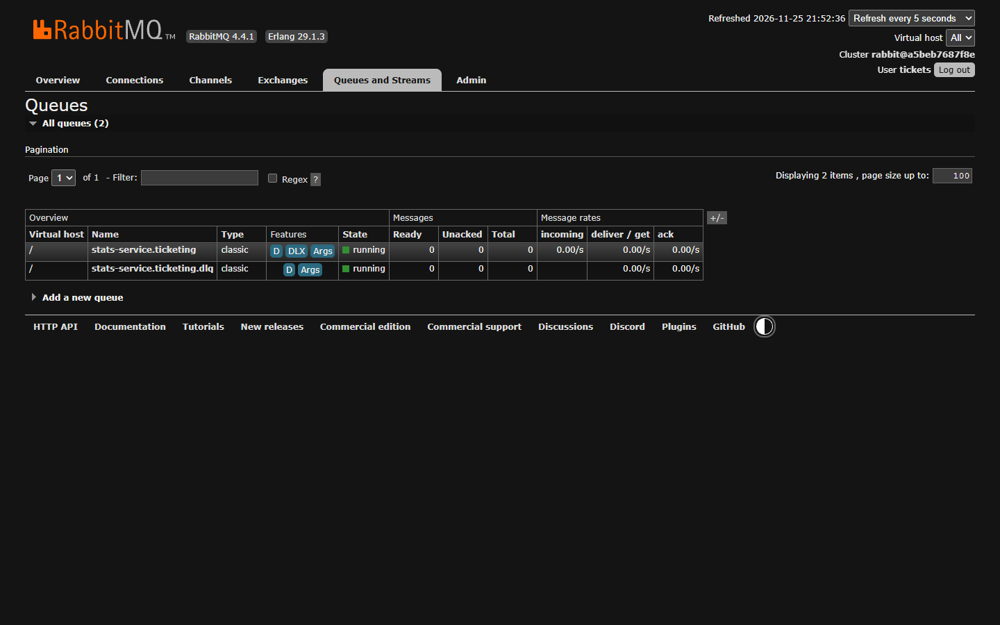

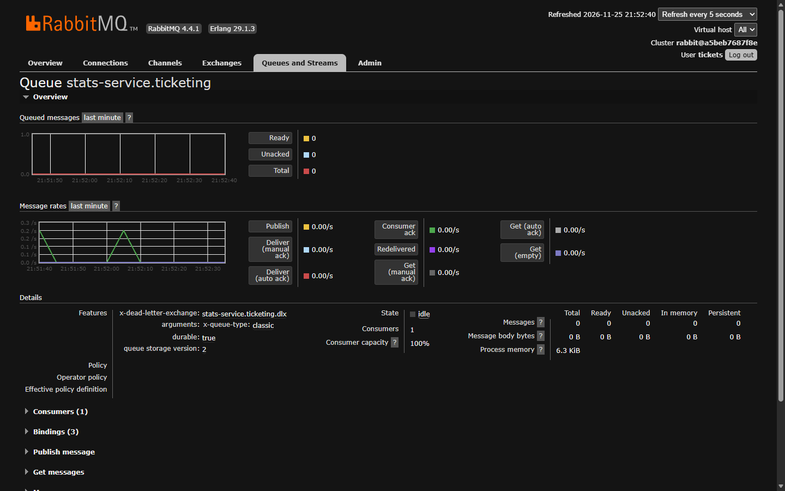

**La traza de la compra.** El clic en "Confirm" de la tienda y el procesamiento del mensaje en .NET forman **una sola traza**, aunque el mensaje viajó por RabbitMQ: el `traceparent` va guardado en el outbox y como header AMQP.

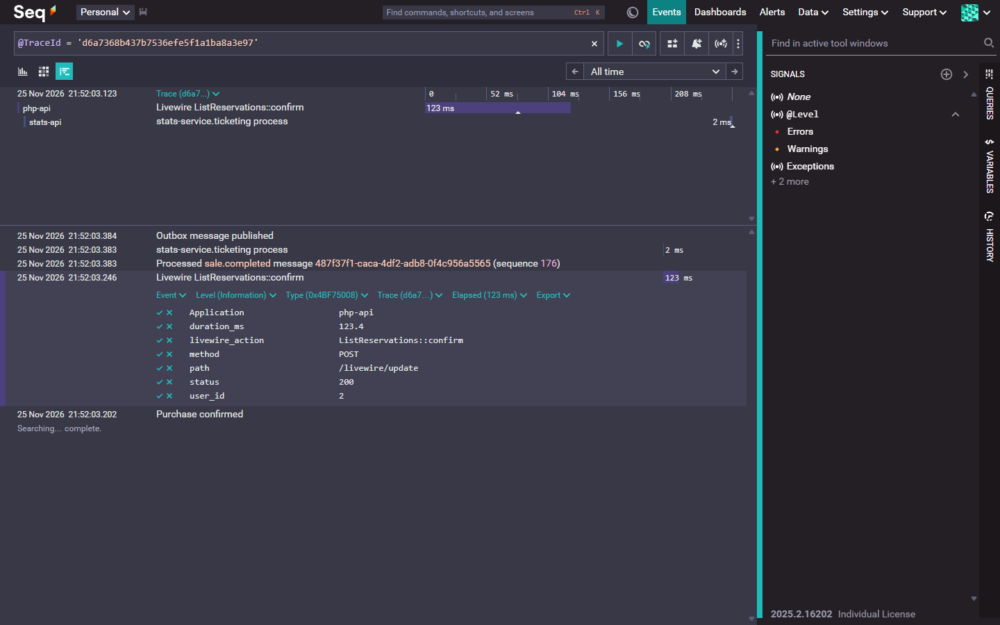

Orden de los eventos de esa traza: `Purchase confirmed` (php-api) → `Livewire ListReservations::confirm` (span de la petición) → `Processed sale.completed … (sequence 176)` (stats-api) → `Outbox message published` (php-outbox).

**El recorrido completo de la compra.** Reservar y confirmar son dos peticiones y, por tanto, dos trazas. Los eventos de negocio llevan `reservation_id`, así que filtrando por él aparecen ambos pasos, cada uno enlazado a su traza:

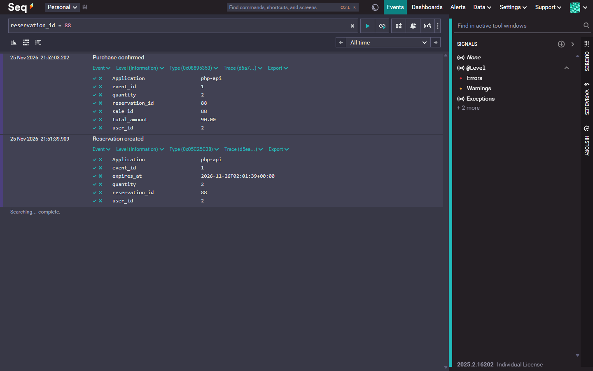

---

## 3. .NET → PHP: fallback HTTP

.NET mantiene una réplica de los eventos alimentada por RabbitMQ. Si un evento no está en la réplica (por ejemplo, tras reiniciar .NET), lo pide a PHP por HTTP. Para provocarlo se reinicia `stats-api` y se consulta un evento:

```bash
docker compose restart stats-api
curl -s http://localhost:5000/api/stats/events/2 -H "X-Api-Key: dev-stats-key"
```

```json
{ "event": { "id": 2, "name": "Jazz Night at the Opera", "status": "published" },
  "tickets": { "total": 120, "sold": 50, "on_hold": 0, "available": 70, "occupancy_percent": 41.67 }, "...": "..." }
```

La primera consulta hace **1 llamada** a PHP; la segunda, **0** (el evento ya está en la réplica). La traza encadena los dos servicios, con cada span colgado de su padre:

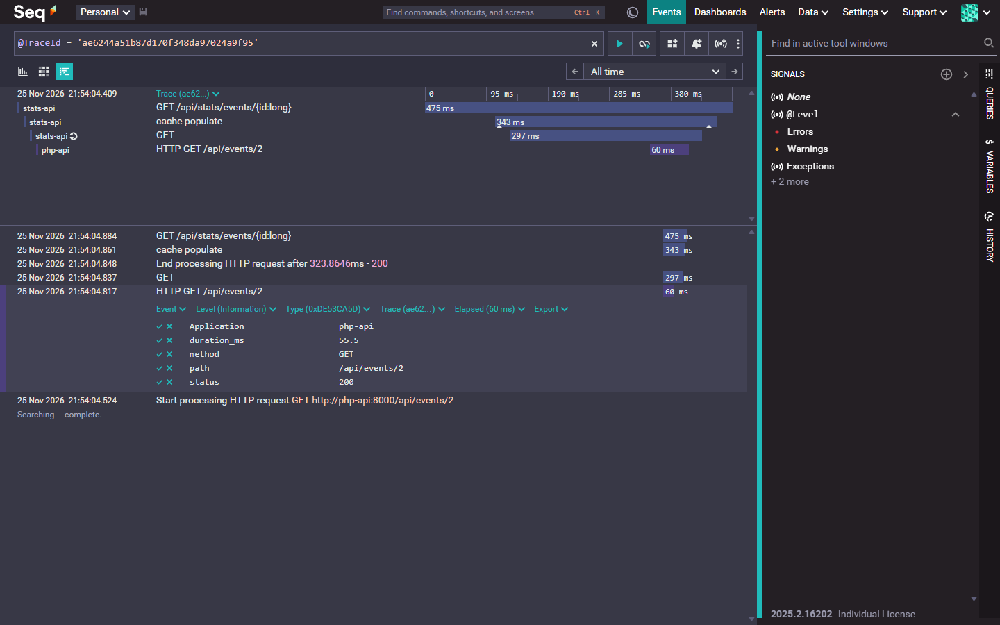

| Span | Servicio | Duración |
|---|---|---|
| `GET /api/stats/events/{id}` | stats-api | 475 ms |
| └ `cache populate` | stats-api | 343 ms |
| &nbsp;&nbsp;└ `GET` (HttpClient con reintentos y circuit breaker) | stats-api | 297 ms |
| &nbsp;&nbsp;&nbsp;&nbsp;└ `HTTP GET /api/events/2` | php-api | 60 ms |

---

## 4. Resiliencia

### .NET caído

Con `stats-api` detenido (`docker compose stop stats-api`):

- **La tienda sigue vendiendo.** Reserva y compra por la API responden `201`:

  ```
  POST /api/events/4/reservations   → HTTP 201  {"data":{"id":89,"event_id":4,"quantity":1,"status":"pending",…}}
  POST /api/reservations/89/confirm → HTTP 201  {"data":{"id":89,"total_amount":"25.00","status":"completed",…}}
  ```

- **El dashboard se degrada sin romperse.** Los widgets muestran un aviso en lugar de un error:

  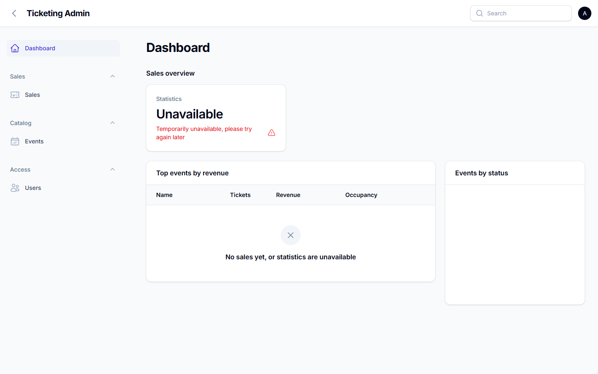

- **Los mensajes esperan en la cola durable.** Mientras .NET está caído, RabbitMQ retiene los mensajes de esa compra; al volver, .NET los consume y las estadísticas reflejan la venta:

  | Estado | Consumidores | Mensajes en cola |
  |---|---|---|
  | .NET caído | 0 | 2 |
  | .NET de nuevo arriba | 1 | 0 |

  *Stand-up Comedy Marathon* pasa de 34 a **35** entradas vendidas en .NET.

### RabbitMQ caído

Con el broker detenido (`docker compose stop rabbitmq`), un cliente compra 3 entradas de *Tech Summit 2026* (56 vendidas antes):

1. **La compra se completa igual** (`201`). Los mensajes quedan pendientes en el outbox, guardados en la misma transacción que la venta, sin perderse:

   ```
    id  |      type      | created  |  published
   -----+----------------+----------+-------------
    179 | event.changed  | 01:56:26 | (pendiente)
    180 | sale.completed | 01:56:27 | (pendiente)
   ```

2. **El relay reintenta con backoff exponencial** sin saturar nada (10 intentos en 4 minutos, con esperas de 2, 4, 8, 16 y luego 30 segundos):

   ```
   Outbox relay failed, messages stay pending  {"error":"Connection reset by peer","attempt":1}
   Outbox relay failed, messages stay pending  {"error":"…getaddrinfo for rabbitmq failed…","attempt":2}
   …
   Outbox relay failed, messages stay pending  {"error":"…getaddrinfo for rabbitmq failed…","attempt":10}
   ```

3. **El sistema avisa solo.** A los 2 minutos, `outbox:monitor` (en el scheduler) registra `Outbox backlog: 2 message(s) pending for more than 120 s` y Seq dispara la alerta *Outbox backlog* (sección 5).

4. **Al volver el broker, todo se recupera sin intervención.** El relay publica los mensajes pendientes en orden, .NET se reconecta y aplica la venta: *Tech Summit 2026* pasa de 56 a **59** vendidas.

   ```
    id  |      type      | created  | published
   -----+----------------+----------+-----------
    179 | event.changed  | 01:56:26 | 02:00:31
    180 | sale.completed | 01:56:27 | 02:00:31
   ```

   ```
   php-outbox  Outbox message published  {"type":"event.changed","sequence":179,"trace_id":"91543f89…"}
   php-outbox  Outbox message published  {"type":"sale.completed","sequence":180,"trace_id":"3237b053…"}
   stats-api   RabbitMQ unavailable, retrying in 00:00:30
   stats-api   Consuming messages from queue stats-service.ticketing
   ```

**La traza sobrevive a la caída.** El procesamiento en .NET, cuatro minutos después, cuelga de la misma traza que la compra original, porque el `traceparent` viajó guardado en el outbox. El eje de tiempo de la vista de traza llega a 196 s:

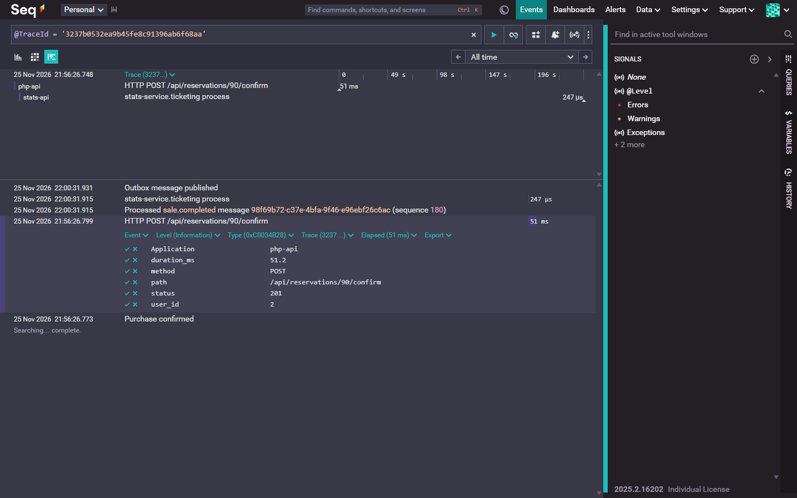

---

## 5. Errores rastreables, dead-letter queue y alertas

### Un error con su `trace_id`

Toda respuesta de error de ambos servicios incluye el `trace_id`, también en el header `X-Trace-Id` de PHP:

```
GET http://localhost:8000/api/events/99999
HTTP/1.1 404 Not Found
X-Trace-Id: 6d546f44e2b8363c193300c3ba4612dc
{"message":"Resource not found.","trace_id":"6d546f44e2b8363c193300c3ba4612dc"}
```

```
GET http://localhost:5000/api/stats/events/99999
HTTP/1.1 404 Not Found
{"type":"https://tools.ietf.org/html/rfc9110#section-15.5.5","title":"Event 99999 was not found.","status":404,"trace_id":"14e5b81c9f63614e953c14248237fa3e"}
```

El segundo error atraviesa los dos servicios: .NET no conoce el evento, lo pide a PHP, PHP responde 404 y .NET devuelve su propio 404 con el mismo `trace_id`. Buscándolo en Seq aparece la cadena completa; el punto rojo marca la llamada que falló:

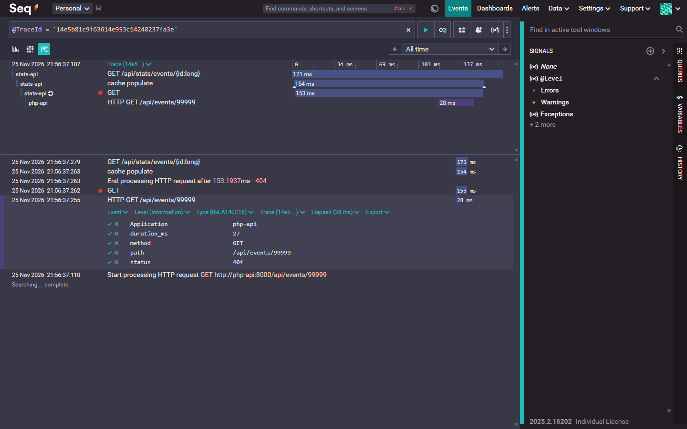

### Un mensaje que .NET no puede procesar

Se publica a mano en RabbitMQ un mensaje con el cuerpo inválido y un `traceparent` conocido. El consumidor lo rechaza sin reintentarlo en bucle, registra el error con esa traza y el mensaje queda en la dead-letter queue **conservando su `traceparent`**, de modo que desde la cola se llega a la traza del fallo:

```
stats-api  Error  Message malformed-1 failed and was dead-lettered   TraceId=0bad0bad0bad0bad0bad0bad0bad0bad
```

```json
{
  "queue": "stats-service.ticketing.dlq",
  "message_id": "malformed-1",
  "traceparent": "00-0bad0bad0bad0bad0bad0bad0bad0bad-00f067aa0ba902b7-01",
  "x-first-death-reason": "rejected",
  "x-first-death-queue": "stats-service.ticketing",
  "payload": "{\"message_id\":\"not-a-guid\",\"type\":\"event.changed\"}"
}
```

### Alertas

Las tres alertas de Seq se dispararon durante estas pruebas sin intervención manual:

| Alerta | Qué la disparó |
|---|---|
| **Outbox backlog** | Los 2 mensajes retenidos con RabbitMQ caído (sección 4) |
| **Errors in any service** | El span de la llamada .NET → PHP que falló con 404 y, después, el mensaje inválido |
| **Dead-letter queue not empty** | El aviso periódico del consumidor .NET: `Dead-letter queue stats-service.ticketing.dlq holds 1 message(s)` |

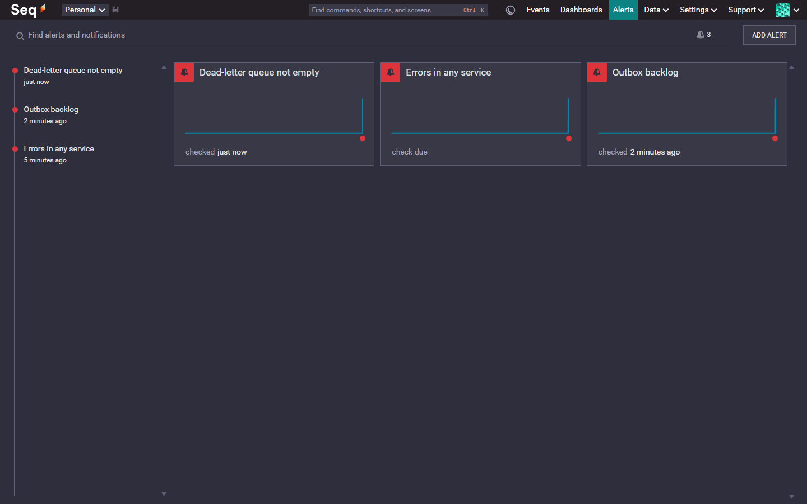

---

## 6. Cómo reproducirlo

```bash
# Estado inicial limpio
docker compose up -d --build
docker compose exec php-api php artisan migrate:fresh --seed

# 1 · PHP → .NET: abrir http://localhost:8000/admin (admin@tickets.test / admin1234)
curl -s "http://localhost:5000/api/stats/summary?top=3" -H "X-Api-Key: dev-stats-key"

# 2 · Compra: reservar y confirmar en la tienda (customer@tickets.test / customer1234)
#     y consultar el evento antes y después
curl -s http://localhost:5000/api/stats/events/1 -H "X-Api-Key: dev-stats-key"

# 3 · Fallback
docker compose restart stats-api
curl -s http://localhost:5000/api/stats/events/2 -H "X-Api-Key: dev-stats-key"

# 4 · Resiliencia
docker compose stop stats-api    # comprar en la tienda y abrir el dashboard
docker compose start stats-api
docker compose stop rabbitmq     # comprar y esperar ~3 minutos
docker compose start rabbitmq

# 5 · Error rastreable
curl -s http://localhost:8000/api/events/99999 -H "Accept: application/json"
```

En Seq, cualquier `trace_id` de los anteriores se busca con `@TraceId = '<trace_id>'` y se abre con *Trace → Show*; el recorrido de una compra, con `reservation_id = <id>`.
